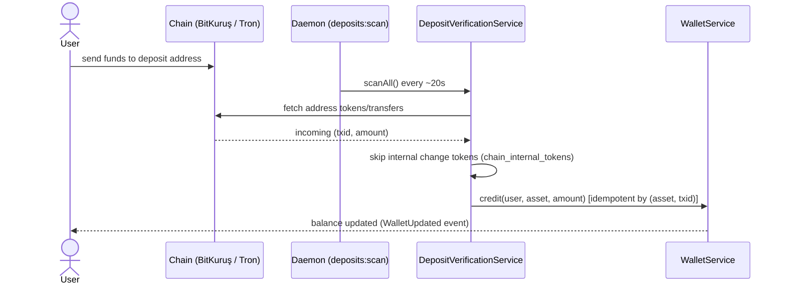
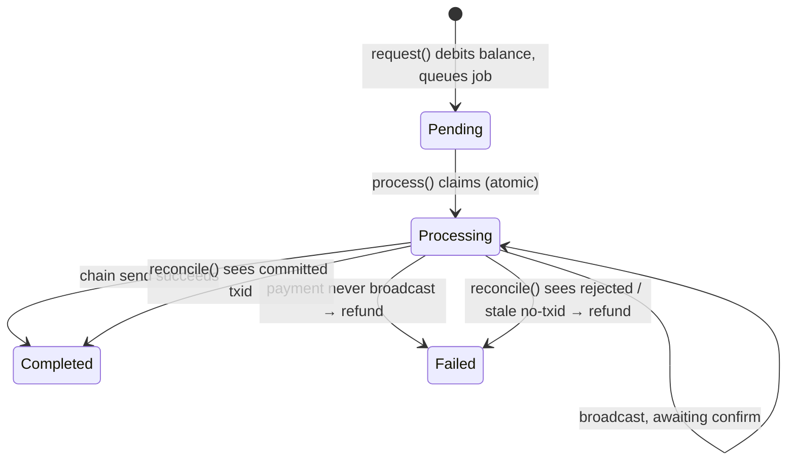

# Architecture / Mimari

> EN with a short Turkish summary at the end. / Sonunda kısa Türkçe özet.

## Layering

Business logic lives **only** in `app/Services/`. Controllers are thin (request → service →
response). Models hold relations/casts/scopes only. Validation is in Form Requests, constants in
Enums, side effects in Jobs/Events. Money mutations always run inside `DB::transaction` with
`lockForUpdate` and record a double-entry `ledger_entries` row.

```
HTTP / Console
   │
Controller / Command      ← thin
   │
Service (app/Services/)   ← ALL business logic
   │
Model / Chain client / Node signer
```

## Services map

| Service | Responsibility |
| --- | --- |
| `OrderService` | Order lifecycle: validate, lock funds, create, orchestrate matching. |
| `MatchingEngineService` | Price-time matching, fills, fees, refunds, self-trade prevention. |
| `WalletService` | The single gate for balance mutations (credit/debit/lock/unlock) + ledger. |
| `DepositService` | Legacy/simulated deposit (admin/demo tools only). |
| `DepositVerificationService` | Real chain deposit detection + crediting (BK$ + USDT). |
| `WithdrawalService` | Withdrawal request, async processing, and reconciliation. |
| `MarketDataService` | Read models for order book / ticker / wallets. |
| `Chain/*` | Chain clients, verifiers, and withdrawal senders (see CHAIN_INTEGRATION.md). |
| `Admin/*` | Market settings, market-maker bot, transaction simulator. |

## Matching engine

- **Price-time priority.** Best price first; ties broken by order id (arrival order).
- **Execution at the maker price** (the resting order's price).
- **Order types:** limit and market; partial fills leave a remainder resting (limit) or cancel
  the unfilled portion (market).
- **Fees:** taker pays `taker_fee`, maker pays `maker_fee`; retained implicitly (fill credited
  net of fee).
- **Self-trade prevention (STP):** a user cannot match their own resting orders
  (`bestMaker` and the market-order book check exclude the same `user_id`).
- **Concurrency:** the market row is `lockForUpdate`-locked in `OrderService::place`, serializing
  all matching for a market. Makers are also row-locked while filling.
- **Precision:** all arithmetic uses `App\Support\BigMath` (bcmath, 18 decimals). Order price and
  quantity are truncated to the market's `price_scale` / `size_scale`.

## Money safety

Every credit/debit/lock/unlock goes through `WalletService`, which:
1. Locks the wallet row (`lockForUpdate`).
2. Mutates `available` / `locked` with `BigMath`.
3. Writes a `ledger_entries` row (audit trail).
4. Emits a `WalletUpdated` event (live UI).

`InsufficientBalanceException` (a `DomainException`) rolls the transaction back, so no partial
state is ever persisted.

## Deposit verification (real chain)

Deposits are **never** self-credited by user input. A user sends funds to their deposit address;
the exchange detects it on-chain and credits the real amount.



- **BK$:** UTXO model — each active token (`token_id`) the deposit address owns is an incoming
  deposit; dedup by `token_id`.
- **USDT:** TronGrid TRC20 transfers to the address; dedup by transaction id.
- **Change tokens:** a withdrawal's change output returns to the sender's own address. These are
  recorded in `chain_internal_tokens` so the scanner does **not** re-credit them as deposits.

## Withdrawal (real chain + reconciliation)

Withdrawals are processed asynchronously with a claim + reconcile model so a crash never loses
funds or double-sends.



Key invariants:
- Balance is **reserved (debited)** synchronously on request.
- The **txid is recorded before broadcast**, so reconciliation can check the exact transaction.
- The only fund-moving step is the *payment* (transfer/split for BK$, TRC20 transfer for USDT);
  BK$ merge outputs stay at the user's own address, so refunding when no payment was broadcast is
  safe.
- `ProcessWithdrawalJob` has `tries = 1` (no auto-retry → no double-send). Stuck `Processing`
  withdrawals are resolved by `withdrawals:reconcile` (run by the daemon).

## Events & realtime

Domain events (`OrderBookUpdated`, `TradeExecuted`, `WalletUpdated`, `SystemStatsUpdated`) are
broadcast over Laravel Reverb (WebSocket). The frontend subscribes via `@laravel/echo-vue`.

## Autonomous daemon

`php artisan borsa:daemon` runs one loop that: scans deposits (`deposits:scan`), reconciles
withdrawals (`withdrawals:reconcile`), runs the market-maker bot + simulator, drains the queue,
and broadcasts stats. See [DEPLOYMENT.md](DEPLOYMENT.md) for running it as a service.

---

## Türkçe özet

İş mantığı yalnızca `app/Services/` katmanındadır. Para işlemleri `DB::transaction` +
`lockForUpdate` + `ledger_entries` ile yapılır. Eşleştirme motoru fiyat-zaman önceliği, maker
fiyatı, self-trade koruması ve market-bazlı kilitleme kullanır. Yatırmalar kullanıcı girdisiyle
değil **zincirden** doğrulanır (BK$ UTXO/token, USDT TronGrid); çekimin para üstü token'ları
`chain_internal_tokens` ile ayrılır. Çekimler async + `Processing` claim + txid-önce-broadcast +
`reconcile` modeliyle işlenir; böylece çökme durumunda fon kaybı veya çift gönderim olmaz.
